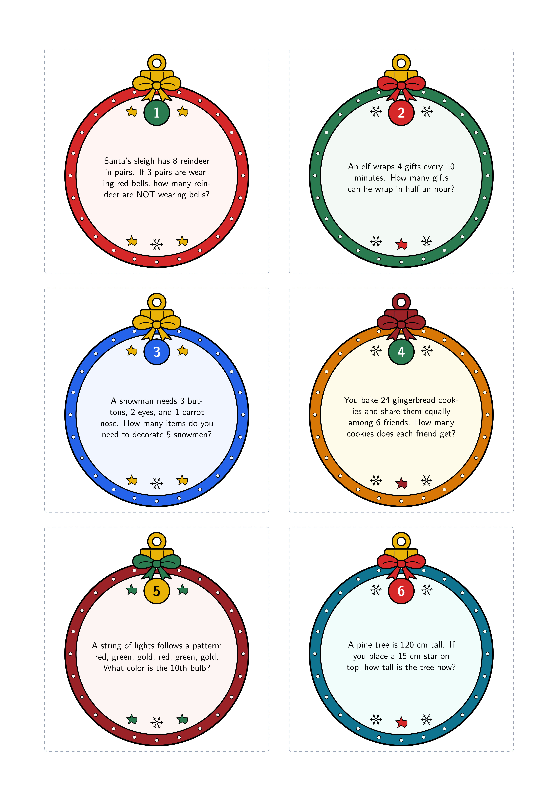
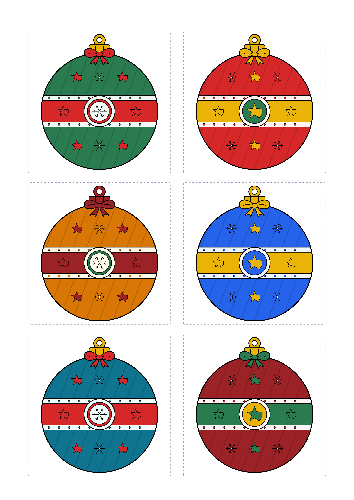
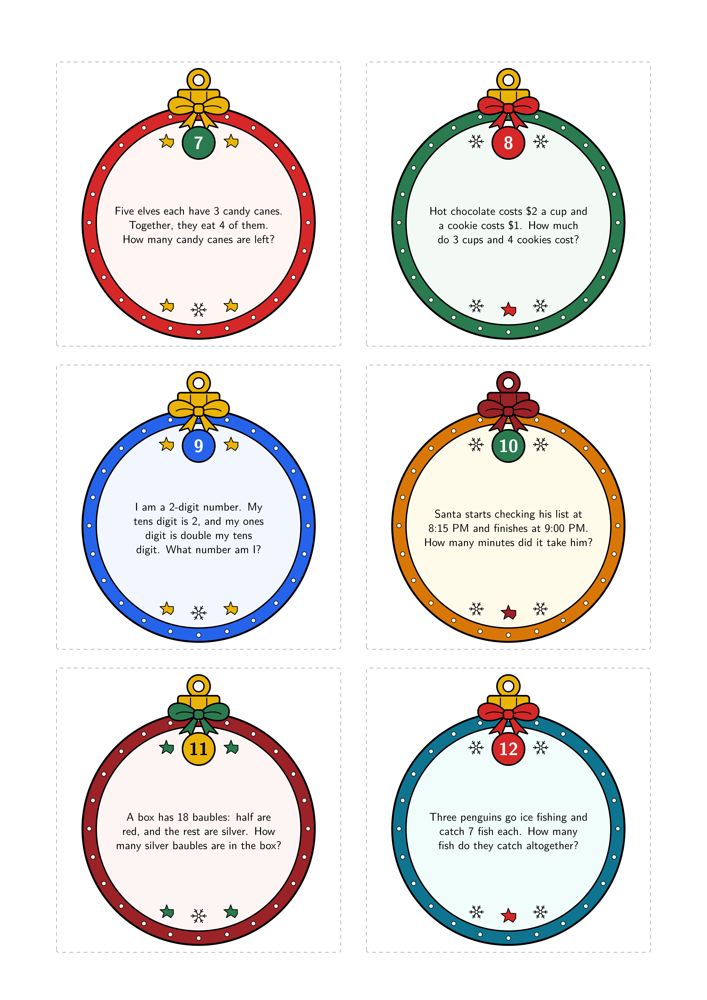
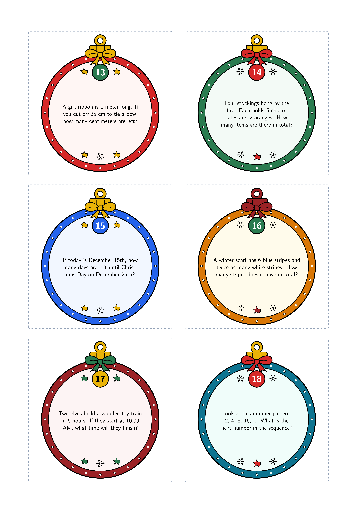
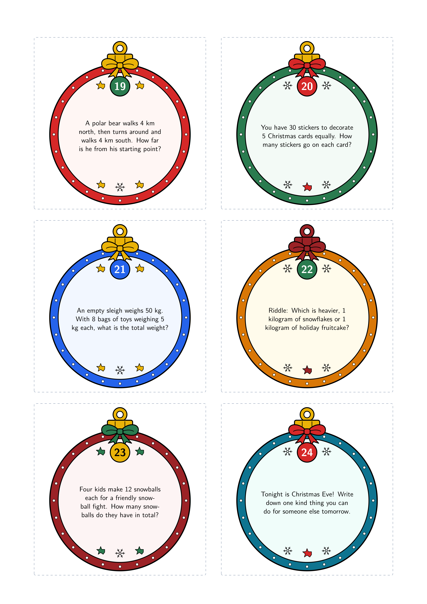
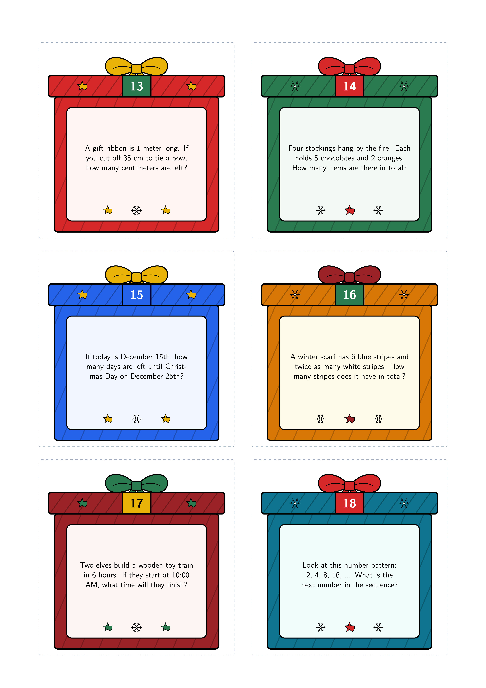
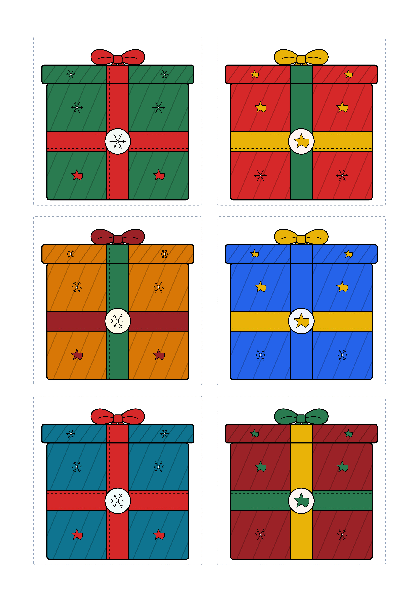
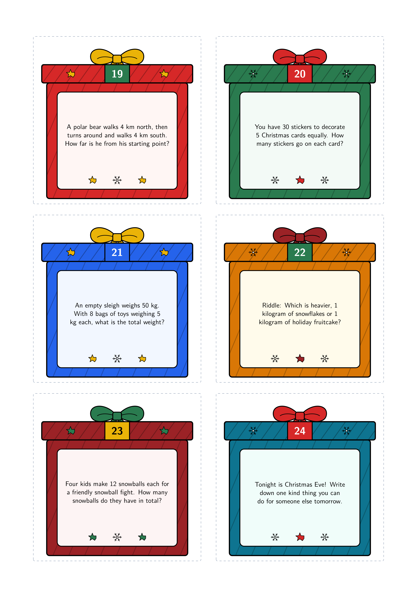

<h1>LaTeX template for a printable Advent Calendar (Christmas baubles &amp; gift boxes)</h1>

  A customizable, print-ready LaTeX template to generate Advent calendars shaped like
  <strong>Christmas baubles</strong> and <strong>gift boxes</strong>. Ideal for teachers,
  parents, and makers to create daily math problems, riddles, challenges, or quotes for kids.
  Supports <strong>color</strong> and <strong>black &amp; white (coloring-page)</strong> modes,
  cut guides, and <strong>auto-aligned duplex (double-sided) printing</strong>.

<h2>Demo images</h2>

  <a href="http://paypal.me/R0mb0">
    <picture>
      <source media="(prefers-color-scheme: dark)" srcset="https://github.com/R0mb0/Support_the_dev_badge/blob/main/Badge/SVG/Support_the_dev_badge_Dark.svg">
      <source media="(prefers-color-scheme: light)" srcset="https://github.com/R0mb0/Support_the_dev_badge/blob/main/Badge/SVG/Support_the_dev_badge_Light.svg">
      
    </picture>
  </a>

<!-- ==================== INSTRUCTIONS ==================== -->
<h2>How to create your personal Advent Calendar online for free!</h2>

<ol>
  <li>Fork this repository by pressing the <strong>Fork</strong> button at the top right.</li>
  <li>Rename the repository as you want, optionally change the description, and create the fork.</li>
  <li>
    ⚠️ You have to activate <strong>Actions</strong> on your repo: go to the <strong>Actions</strong> tab and click on
    <em>"I understand my workflows, go ahead and enable them"</em>. ⚠️
  </li>
  <li>
    Personalize the document properties and daily texts:
    <ol>
      <li>Open <code>advent_calendar.tex</code> from the repository.</li>
      <li>Click on <strong>Edit this file</strong> (the pencil icon on the top right).</li>
      <li>Follow the comments at the top of the file to configure style, colors, back side, and the 24 daily texts:</li>
    </ol>
  </li>
</ol>

<pre><code class="language-tex">% ================================================================================
%                                  Parameters
% ================================================================================

% Shapes to generate (true / false)
\showbaublestrue        % Generate Christmas baubles
\showgiftstrue          % Generate gift boxes

% Color mode (true = full color, false = B&amp;W coloring-page version)
\colorversiontrue

% Dashed cut guides around each item (true / false)
\showcutguidestrue

% Back-side mode for duplex printing:
%   0 = Front only (no back pages)
%   1 = Same as front (identical graphic and text)
%   2 = Decorative back (matching bauble/gift back design)
%   3 = Custom text on the back (e.g., solutions or a fixed message)
\def\backmode{2}

% Daily texts (Days 1 to 24)
\defineDay{1}{Your Day 1 problem, riddle, or quote here...}
\defineDay{2}{Your Day 2 problem, riddle, or quote here...}
% ... up to Day 24
</code></pre>

<ol start="5">
  <li>Click <strong>Commit changes</strong>.</li>
  <li>
    Wait about 2 minutes, then go to <strong>Actions</strong> &rarr; <strong>Compile</strong> &rarr;
    click on the latest workflow run &rarr; scroll down and download the <strong>artifact file</strong> (PDF).
  </li>
  <li>
    Done! Print your Advent Calendar (if using back modes <code>1</code>, <code>2</code>, or <code>3</code>,
    print <strong>double-sided / flip on long edge</strong> so fronts and backs align automatically),
    cut along the guides, and enjoy! :)
  </li>
</ol>

<!-- ==================== LICENSE ==================== -->
<h2>License</h2>

  Shield:
  

  This work is licensed under a
  <a href="http://creativecommons.org/licenses/by-nc-sa/4.0/">
    Creative Commons Attribution-NonCommercial-ShareAlike 4.0 International License
  </a>.

  

 <a href="https://github.com/R0mb0/Not_made_by_AI">
  <picture>
    <source media="(prefers-color-scheme: dark)" srcset="https://github.com/R0mb0/Not_made_by_AI/blob/main/Badge/SVG/NotMadeByAIDark.svg">
    <source media="(prefers-color-scheme: light)" srcset="https://github.com/R0mb0/Not_made_by_AI/blob/main/Badge/SVG/NotMadeByAILight.svg">
    
  </picture>
</a>
